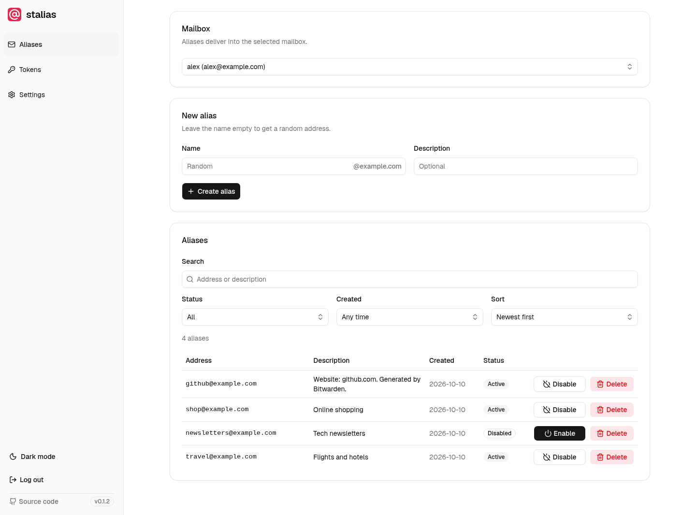

<!-- markdownlint-disable MD033 -->
<h1 align="center">
  <picture>
    <source media="(prefers-color-scheme: dark)" srcset="docs/images/logo-dark.svg">
    
  </picture>
</h1>

<p align="center">
  <a href="https://github.com/UntoastedToast/stalias/releases"></a>
  <a href="https://www.rust-lang.org"></a>
</p>

Email aliases for [Stalwart Mail Server](https://stalw.art), created from your password manager.

stalias provides an [Addy.io](https://addy.io)-compatible API for Stalwart. It was built for
Bitwarden's "Forwarded email alias" generator. Other clients can use it if they support a
custom Addy.io server URL and the endpoints in the [API reference](docs/api.md).

Create a separate address for each login and receive its mail in your existing mailbox.
Use the web UI to search, filter, disable or delete aliases. Disabling an alias makes
Stalwart reject incoming mail with `550 Mailbox does not exist`.

<p>
  <picture>
    <source media="(prefers-color-scheme: dark)" srcset="docs/images/dashboard-dark.png">
    
  </picture>
</p>

- Works with Stalwart Community 0.16 or newer, using your existing mail server and ports.
- Stores aliases in Stalwart and runs in a container of about 20 MB with one data volume.
- Alias domains must have no catch-all, so disabled aliases stop receiving mail.

## Quick start

Run stalias next to your Stalwart container:

```sh
docker run -d --name stalias \
  --network <network-of-your-stalwart-container> \
  -p 127.0.0.1:8080:8080 \
  -v stalias-data:/data \
  ghcr.io/untoastedtoast/stalias:latest
```

You can also use the [Compose example](docs/examples/compose.yml) or deploy the image
with Coolify or Portainer. For production, use HTTPS and follow the
[reverse proxy instructions](docs/configuration.md#reverse-proxy).

Open `http://localhost:8080` and get the setup code with `docker logs stalias`.
The browser wizard explains each of its four steps:

1. Choose an admin password with 12 to 128 characters and no spaces. stalias rejects guessable and leaked passwords.
2. Connect Stalwart using its URL and an API key with the [required permissions](docs/configuration.md#stalwart-api-key).
3. Select the domains allowed for aliases.
4. Create a mailbox token and copy the Bitwarden settings.

stalias stores the Stalwart API key in plain text in the data volume. The key can change
every mailbox, so protect the volume and admin UI. See [configuration and deployment](docs/configuration.md)
for environment variables, image verification and operational limits.

## Bitwarden

Generator → Username → type **Forwarded email alias** → service **Addy.io**, then:

| Field | Value |
| --- | --- |
| Email domain name | one of the domains you selected |
| API access token | the token from stalias |
| Self-host server URL | the public address of stalias |

Create a token for each mailbox you want to use. Aliases created with that token deliver
mail to that mailbox.

## Admin password

Change your password under **Settings → Security**. If you lose access, reset it in a terminal:

```sh
docker exec -it stalias /stalias reset-admin-password
```

Both actions log out all devices. See [passwords and recovery](docs/passwords.md) for details.

## Documentation

- [Configuration and deployment](docs/configuration.md): environment variables, proxy setup and Stalwart requirements.
- [API reference](docs/api.md): supported Addy.io endpoints and client compatibility.
- [Passwords and recovery](docs/passwords.md): login limits, breach checks and local reset.
- [Development](docs/development.md) and [contributing](CONTRIBUTING.md): builds, tests and project layout.

## Credits

[staliaswarden](https://github.com/romdim/staliaswarden) by romdim and its
[Stalwart 0.16 fork](https://github.com/goingdark-social/staliaswarden) by goingdark-social
introduced the idea of connecting Bitwarden to Stalwart. stalias uses regular account
aliases instead of Enterprise-only masked emails and shares no code with either project.

The web UI uses [Basecoat](https://basecoatui.com) (MIT), [htmx](https://htmx.org) (0BSD),
[Tailwind CSS](https://tailwindcss.com) (MIT), [Lucide](https://lucide.dev) icons (ISC) and the
[Geist](https://vercel.com/font) font (SIL OFL 1.1).

Generated alias names use the English word lists of the
[petname](https://github.com/allenap/rust-petname) crate by Gavin Panella (Apache-2.0).

## License

[AGPL-3.0-only](LICENSE)
